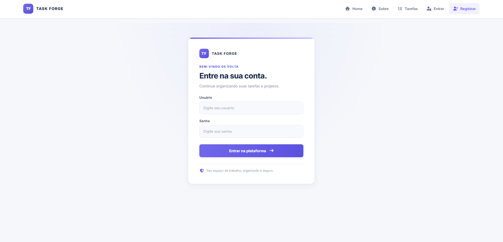
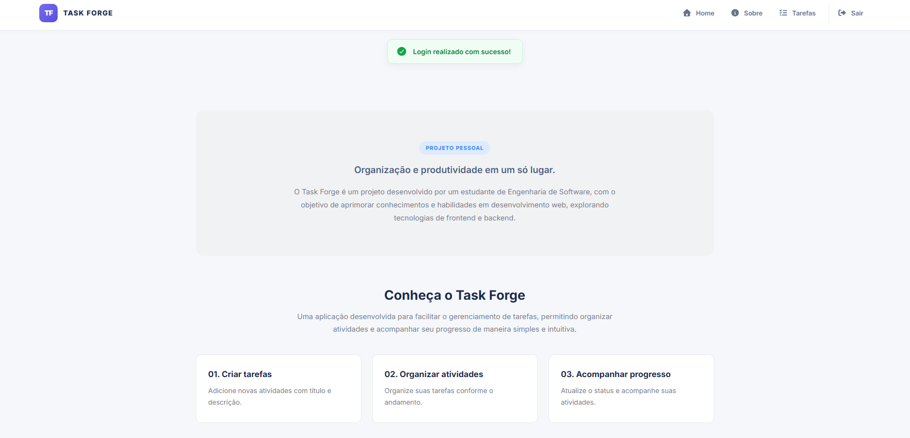
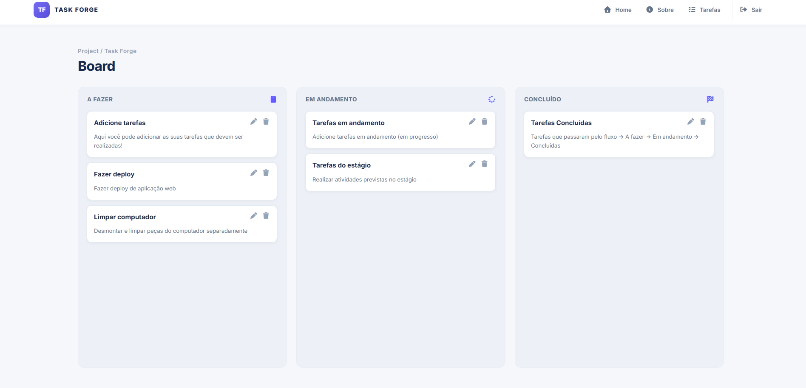

# 🚀 TaskForge

> Sistema **Kanban** para gerenciamento de tarefas, desenvolvido para estudo e prática de desenvolvimento web full stack com JavaScript, Node.js, MongoDB e EJS[cite: 3].

🔗 **Acesse o projeto online:** [TaskForge Live](https://taskforge-2vfr.onrender.com/)[cite: 3]

---

## 📸 Telas da Aplicação

### 🔐 Tela de Login


---

### 🏠 Tela Inicial (Home)


---

### 📋 Quadro Kanban (Tarefas)


---

## 🛠️ Tecnologias Utilizadas


---

## ⚙️ Como rodar o projeto localmente

```bash
# Clone este repositório
git clone [https://github.com/teuscode/taskForge.git](https://github.com/teuscode/taskForge.git)

# Acesse a pasta do projeto
cd taskForge

# Instale as dependências
npm install

# Configure suas variáveis de ambiente (.env) com a URI do MongoDB

# Inicie o servidor
node server.js
